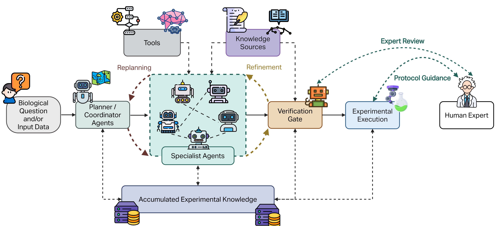
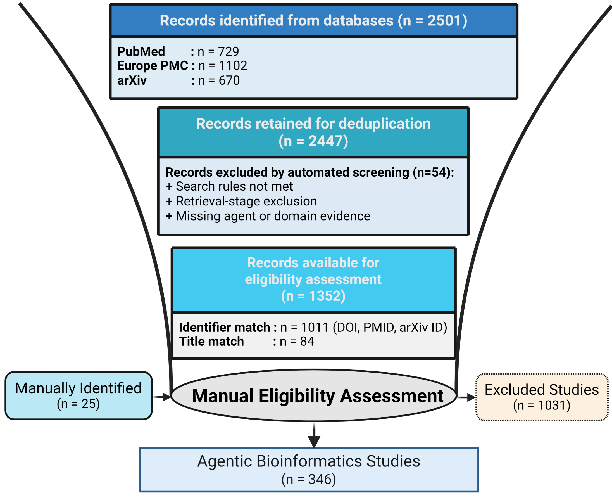

# Evaluating Agentic Bioinformatics through Functionality, Evidence, and Validation

This repository provides the reproducible literature-retrieval and candidate-screening pipeline used to construct the evidence map for the manuscript **“Evaluating Agentic Bioinformatics through Functionality, Evidence, and Validation.”**

<p align="center">
  
  <em>
  Conceptual overview of agentic bioinformatics.
  </em>
</p>

The pipeline searches **PubMed**, **Europe PMC**, and **arXiv**; applies explicit and implicit agent-retrieval strategies; verifies biological-domain evidence; preserves retrieval provenance; standardizes records from different sources; filters ineligible entries; deduplicates publications; assigns each candidate a primary domain and preliminary record type; and exports review-ready files for human verification.


## Workflow
<p align="center">
  
  <em>
Overview of the literature retrieval, filtering, deduplication, domain assignment, and human-verification workflow.
  </em>
</p>


```text
config/search_config.json
        |
        v
run_all_searches.py
        |
        +--> arXiv
        +--> Europe PMC
        +--> PubMed
        |
        v
data_raw/
        |
        v
run_filter.py
        |
        +--> combine
        +--> filter
        +--> deduplicate
        +--> assign domains and export
        |
        v
data/04_candidates_sorted_by_domain.csv
        |
        v
Human verification and final FEV coding
```

## Quick start

Python 3.10 or later is recommended.

Option 1: Create the complete Conda environment

```bash
conda env create -f environment.yml -n fev
conda activate fev
```

Option 2: Install the Python dependencies

```bash
conda create -n fev python=3.10 -y
conda activate fev
python -m pip install -r requirements.txt
```

Review the search settings in:

```text
config/search_config.json
```

Then run:

```bash
python run_all_searches.py
python run_filter.py
```

The manuscript search interval is **2022-01-01 through 2026-09-01**.

Optional environment variables:

```bash
export NCBI_API_KEY="your-api-key"
export FEV_PROJECT_ROOT="/absolute/path/to/BioAgents"
```

## Repository structure

```text
config/                  Search vocabulary and execution settings
crawl_data/              Source-specific retrieval scripts
 data_raw/               Raw retained and rejected retrieval records
filter/                  Combination, filtering, deduplication, and export stages
data/                    Screening outputs and human-review files
logs/                    Timestamped retrieval logs
outputs/reports/         Pipeline manifests and count summaries
visualization/           Figure and statistical-analysis scripts
run_all_searches.py      Retrieval entry point
run_filter.py            Post-retrieval processing entry point
requirements.txt         Python dependencies
```

## Retrieval

The retrieval pipeline searches **arXiv**, **Europe PMC**, and **PubMed** using explicit agent terms and an implicit functional-agent route defined in `config/search_config.json`.

Run all sources:

```bash
python run_all_searches.py
```

Run selected sources:

```bash
python run_all_searches.py --sources pubmed
python run_all_searches.py --sources europe_pmc arxiv
```

Source outputs are written to:

```text
data_raw/arxiv/
data_raw/europe_pmc/
data_raw/pubmed/
```

Do not manually edit `data_raw/`; it forms the retrieval audit trail. Review `logs/` for failed requests, rate-limit waits, warnings, or incomplete searches before filtering.

## Screening pipeline

`run_filter.py` executes four ordered stages:

1. combine source files;
2. apply the post-retrieval eligibility gate;
3. deduplicate by DOI, PMID, arXiv identifier, and normalized title;
4. assign domains, classify candidate type, sort records, and export review files.

```bash
python run_filter.py
```

Primary output:

```text
data/04_candidates_sorted_by_domain.csv
```

Supporting reports:

```text
outputs/reports/input_file_manifest.csv
outputs/reports/domain_data_type_counts.csv
```

> **Important:** The crawler supports implicit functional-agent retrieval, but the current post-combination gate requires nonempty `explicit_agent_hits`. Records retained only through implicit evidence may therefore be excluded. Confirm that this behavior is intended before generating the final review set.

## Human verification and independent coding

The `data/HumanVerification/` directory contains the manually reviewed datasets used to produce the final evidence map:

```text
data/HumanVerification/
├── HumanVerification.csv    Eligibility review of automated candidates
├── ManuallyIdentified.csv   Records added through targeted searches or citation tracing
├── AgenticSystem.csv        Final system-use-case FEV coding
└── Benchmark.csv            Final benchmark and evaluation-resource coding
```

These files preserve the reviewed publication identifiers, eligibility decisions, exclusion reasons, biological domains, agentic status, FEV assignments, supporting evidence, and adjudication notes used in the manuscript. `AgenticSystem.csv` is the primary source for record-level analyses and figures.

The `data/independent_coding/` directory contains the materials used for the independent coding-reliability exercise:

```text
data/independent_coding/
├── FEV_Independent_Coding_Form.pdf    Coding instructions and reviewer form
├── IndependentCoding.csv              Independent pre-adjudication assignments
└── MissMatch.csv                      Disagreements identified for adjudication
```

`IndependentCoding.csv` preserves the reviewers' original coding decisions, while `MissMatch.csv` records assignments that differed and required review. These files are kept separate from the finalized consensus data so that pre-adjudication agreement can be audited.

## Visualization and analysis

The `visualization/` directory contains the scripts and generated outputs used for manuscript figures and quantitative analyses:

```text
visualization/
├── association_analysis.py      Association and publication-year analyses
├── visualization.py             Main descriptive FEV figures
├── build_PRISMA.py              Prepares PRISMA flow inputs
├── visualization_PRISMA.py      Renders the PRISMA-style flow diagram
├── association_outputs/         Tables, summaries, and outputs from association analyses
└── statistical_figures/         Exported statistical and manuscript-ready figures
```

Generate figures and association analyses from the finalized coding data:

```bash
python visualization/visualization.py
python visualization/association_analysis.py \
  --input data/HumanVerification/AgenticSystem.csv \
  --output-dir visualization/association_outputs \
  --dpi 300 \
  --exclude-duplicates
```

Use the PRISMA scripts to prepare and render the literature-selection flow diagram:

```bash
python visualization/build_PRISMA.py
python visualization/visualization_PRISMA.py
```
